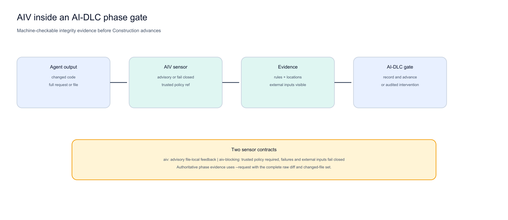

# AIV Integrity Gate

<p align="center">
  <a href="https://github.com/vaquarkhan/aiv-integrity-gate/actions/workflows/aiv.yml"></a>
  <a href="https://central.sonatype.com/artifact/io.github.vaquarkhan/aiv-cli"></a>
  <a href="LICENSE"></a>
  <a href="https://vaquarkhan.github.io/aiv-integrity-gate/"></a>
</p>

<p align="center"><b>A deterministic integrity gate for AI-generated code.</b><br/>
Ask whether a change is backed by objective evidence and get a structured verdict that binds the exact request and resolved policy.</p>

> **Release channels:** Maven Central `1.0.4` and the `@v1` Action provide the stable core gate. The source branch contains the next-release trust boundary, evidence, `aiv verify`, AI-DLC integration, and hardened Action. Build from source and pass the jar through `cli-jar-path` until that release is published.

<p align="center"></p>

**Architecture at a glance.** Every front door reaches the same core. AIV separates the source workspace from an immutable policy snapshot, then publishes one severity-aware result to terminal, JSON, SARIF, GitHub, audit, and report surfaces.

## Why teams use it

AI agents write code faster than anyone can review it. AIV sits at the point where a change is produced and returns objective, repeatable evidence before a human or a long CI matrix ever looks at it:

- **Verified dependency declarations.** Newly declared packages in supported manifests are checked against their registry; unavailable registries are reported as unverified.
- **Tests with assertion evidence.** Added test functions must contain a recognized assertion, expectation, or verification call.
- **Clean diffs.** Merge markers, elision lines (`... existing code ...`), and assistant chatter are caught on added lines.
- **No leaked secrets.** Credential patterns and keyword-bound high-entropy strings are flagged before they ship.
- **It parses.** Changed files are checked for syntax so you never burn a CI run on a guaranteed failure.
- **A tamper-evident trail.** Every verdict can append to a SHA-256 hash chain you can verify later.

With the local deterministic profile, the same request and resolved policy produce the same verdict. `aiv verify` reports the policy digest and declares when enabled gates depend on a package registry, an external tool, or the optional advisory decision model.

## Works with the stack you already have

One engine, many front doors. Call AIV wherever your change is produced.

| Front door | Use it for |
|------------|-----------|
| **pre-commit** | Catch issues on the developer machine, before a PR exists |
| **CI / GitHub Action** | Backstop on every pull request, with SARIF and Checks |
| **`aiv verify` (MCP / agent)** | One JSON request in, one JSON verdict out - callable from any agent, orchestrator, or MCP server |
| **AI-DLC sensor** | Deterministic evidence at an [AI-DLC](https://awslabs.github.io/aidlc-workflows/) phase boundary |
| **Policy engine (OPA)** | Feed verdict facts into a Rego policy decision |

Languages: Java, Python, JavaScript, TypeScript, Go, Kotlin, Scala, Ruby, C, C++, and shell, plus YAML and JSON. Structural and policy checks apply to any path you configure.

## `aiv verify`: the agent-facing entry point

`aiv verify` reads one JSON request and writes one JSON verdict to stdout (diagnostics go to stderr), so any tool can call it the same way regardless of language.

<p align="center"></p>

**Machine contract.** The request is strict RFC 8259 JSON. The response binds the request, canonical config, frozen policy sidecars, and pinned policy commit into one evidence digest.

```bash
echo '{"artifact":{"files":[{"path":"src/A.java","changeType":"MODIFIED","content":"class A {}"}]}}' \
  | java -jar aiv-cli.jar verify --workspace .
```

```json
{
  "verdict": "pass",
  "gates": [ { "id": "package-existence", "passed": true, "findings": [] } ],
  "evidence_digest": "sha256:…",
  "audit": { "record_hash": "…", "log": "verify-audit.log" }
}
```

The `evidence_digest` ties the verdict to the exact inputs, and `--audit-log` appends a tamper-evident record. Full contract: [docs/MCP.md](docs/MCP.md).

## AI-DLC integration

<p align="center"></p>

**Lifecycle integration.** AI-DLC owns stage sequencing and human routing. AIV supplies file-local advisory evidence or full-request fail-closed evidence at the phase boundary.

AIV drops into [AI-DLC](https://awslabs.github.io/aidlc-workflows/) as a deterministic verification sensor. When an agent writes code during the Construction phase, the sensor runs `aiv verify` and returns the machine-checkable evidence the verifier is designed to act on. Advisory by default; promote to blocking when your team is ready.

```bash
export AIV_JAR=/path/to/aiv-cli.jar
python3 integrations/aidlc/aiv_aidlc_sensor.py --file src/App.java
```

Install routes and the sensor manifest: [integrations/aidlc/](integrations/aidlc/) · narrative: [docs/AIDLC.md](docs/AIDLC.md).

## Quick start

You are done when a pull request runs AIV and prints a verdict.

1. **Get the CLI** - the stable release is on Maven Central:

   ```bash
   curl -fsSL -o aiv-cli.jar "https://repo1.maven.org/maven2/io/github/vaquarkhan/aiv/aiv-cli/1.0.4/aiv-cli-1.0.4.jar"
   ```

   For the newest gates and `aiv verify`, build the jar from source:

   ```bash
   git clone https://github.com/vaquarkhan/aiv-integrity-gate.git && cd aiv-integrity-gate
   mvn -q -pl aiv-cli -am clean package
   # jar at aiv-cli/target/aiv-cli-<version>.jar
   ```

2. **Bootstrap config** - writes `.aiv/config.yaml` and starter rules from a quick language sniff:

   ```bash
   java -jar aiv-cli.jar init --workspace .
   ```

3. **Shift left** - add the [pre-commit hook](docs/PRE-COMMIT.md) so issues never reach a PR:

   ```yaml
   repos:
     - repo: https://github.com/vaquarkhan/aiv-integrity-gate
       rev: v1.0.4
       hooks:
         - id: aiv-gate
   ```

4. **Wire CI** - follow the [hardened deployment guide](docs/DEPLOYMENT.md). The next-release Action requires a compatible source/release jar and a positive capability handshake.

5. **Open a pull request** - see a verdict. Start with [Quick start](docs/TUTORIAL.md), then run the [complete all-gates Hello World](docs/HELLO-WORLD.md).

## What it checks

<p align="center"></p>

**Gate catalog.** Change-integrity and behavioral gates produce the strongest objective evidence. Review-focus gates stay advisory. Governance surfaces are opt-in or advisory and all share one result contract.

Hard checks block only on objective, reproducible defects on the diff. Everything softer is advisory - a signal, surfaced but never the sole merge block. The project owns every gate, threshold, scope, and severity in `.aiv/config.yaml`.

| Check | What it proves | Mode |
|-------|----------------|------|
| **syntax** | changed files parse (Java/Python/YAML/JSON in process; JS/TS/Go via the local toolchain) | hard |
| **invariant** | no merge markers, elision lines, assistant chatter, or placeholder tests on added lines | hard |
| **test-adequacy** | added tests assert something; production change with no test is flagged | hard / advisory |
| **package-existence** | declared dependencies exist on PyPI, npm, or Maven Central | hard |
| **dependency** | imports are backed by the project manifest | hard |
| **security** | no hard-coded credentials on added lines | hard |
| **duplication** | added blocks that already exist in the workspace | advisory |
| **density / cohesion** | logic density and multi-area sprawl signals | advisory |
| **rules** | YAML rule packs for any framework (ships an `airflow` pack; add your own in `.aiv/rules/`) | configurable |
| **external** | folds ruff, semgrep, gitleaks, or any SARIF producer into the same verdict | configurable |
| **doc-integrity / pr-metadata / license-header** | docs links and paths, PR hygiene, source headers | opt-in |
| **jev** | calibrated yes/no questions from a decision model, printed beside the evidence | advisory, opt-in |

## The trust boundary

<p align="center"></p>

**Trust boundary.** A symbolic base ref is pinned once. Policy blobs are materialized into a private snapshot, consumed by gates, hashed into evidence, and named by the audit record.

A change cannot switch off the gate that judges it:

- In fail-closed CI (`--require-trusted-config`), policy is read from the **base ref** and the complete `.aiv/` policy tree must match it. That protects config, design rules, rule packs, and baselines together; policy changes are reviewed in a separate run.
- `aiv verify --require-trusted-policy --policy-ref <ref>` also refuses policy-tree drift and binds the resolved base commit into the policy/evidence digest.
- `/aiv skip` is **default-deny** - honored only for an allow-listed author with a good commit signature, and always surfaced.
- A file-level disable must name a rule; a bare directive suppresses nothing.
- When a check cannot run (missing toolchain, unreachable registry) it says so, instead of passing quietly.

## Evidence, reports, and proposals

- **Tamper-evident audit.** Every run can append to a SHA-256 hash chain whose head prints in the CI log and the PR comment; verify later with `aiv audit verify --expect-head`.
- **Evidence report.** `aiv report` turns the audit log into a static HTML report with a per-rule calibration table and a JSONL export for DuckDB.
- **Proposal checks.** `aiv proposal` checks improvement proposals (KIP, FLIP, SPIP on Confluence, JIRA, or files) for missing sections, leftover template text, and content changed after acceptance.

Details: [docs/EVIDENCE-AND-PROPOSALS.md](docs/EVIDENCE-AND-PROPOSALS.md).

## Modules

| Module | Purpose |
|--------|---------|
| [`aiv-api`](aiv-api/README.md) | Gate contract, models, dependency-free utilities (`JsonLite`) |
| [`aiv-core`](aiv-core/README.md) | Orchestrator: skip policy, severity, baseline, suppressions, notices |
| [`aiv-cli`](aiv-cli/README.md) | Command-line entry point and shaded jar; `verify`, base-ref config, audit, subcommands |
| [`aiv-plugin-syntax`](aiv-plugin-syntax/README.md) | `syntax`: changed files must parse |
| [`aiv-plugin-invariant-template`](aiv-plugin-invariant-template/README.md) | `invariant`: markers, placeholders, agent paste artifacts on added lines |
| [`aiv-plugin-dependency`](aiv-plugin-dependency/README.md) | `dependency`: imports must be declared |
| [`aiv-plugin-package-existence`](aiv-plugin-package-existence/README.md) | `package-existence`: dependencies must exist in their registry |
| [`aiv-plugin-security`](aiv-plugin-security/README.md) | `security`: secret patterns and entropy on added lines |
| [`aiv-plugin-test-adequacy`](aiv-plugin-test-adequacy/README.md) | `test-adequacy`: assertion-free tests, missing tests |
| [`aiv-plugin-design`](aiv-plugin-design/README.md) | `design` project rules and `cohesion` |
| [`aiv-plugin-duplication`](aiv-plugin-duplication/README.md) | `duplication`: added blocks already in the workspace |
| [`aiv-plugin-density`](aiv-plugin-density/README.md) | `density`: logic density and entropy |
| [`aiv-plugin-doc-integrity`](aiv-plugin-doc-integrity/README.md) | `doc-integrity`: links, fabricated paths, doc rules |
| [`aiv-plugin-prmeta`](aiv-plugin-prmeta/README.md) | `pr-metadata`: PR title and body hygiene |
| [`aiv-plugin-license-header`](aiv-plugin-license-header/README.md) | `license-header`: headers on added source files |
| [`aiv-plugin-external`](aiv-plugin-external/README.md) | `external`: fold any SARIF producer into the verdict |
| [`aiv-plugin-rules`](aiv-plugin-rules/README.md) | `rules`: generic YAML rule engine with rule packs |
| [`aiv-plugin-jev`](aiv-plugin-jev/README.md) | `jev`: optional decision-model questions, advisory only |
| [`aiv-audit`](aiv-audit/README.md) | SHA-256 hash-chained, tamper-evident log |
| [`aiv-report`](aiv-report/README.md) | Evidence report with per-rule calibration, JSONL export |
| [`aiv-proposal`](aiv-proposal/README.md) | KIP, FLIP, SPIP checks |
| [`aiv-governance`](aiv-governance/README.md) | Standalone delegate/fallback/human-routing library; not bundled in CLI |
| [`aiv-adapter-git`](aiv-adapter-git/README.md) | Git and in-memory diff providers |
| [`aiv-adapter-github`](aiv-adapter-github/README.md) | Stdout, GitHub Checks, review comments, labels |

## Build and run

```bash
mvn clean verify
java -jar aiv-cli/target/aiv-cli-1.0.4.jar --diff origin/main
```

**Exit codes:** `0` pass · `1` a blocking gate failed · `2` bad args/config · `3` git failure.

**Structured output:** `--output-json` (schema with per-gate findings), `--output-sarif` (SARIF 2.1.0), `--publish-github-checks`, `--label-pr-on-advisory`. Machine-only CI: pair `--quiet` with `--output-json`.

Building AIV itself runs unit tests plus 100% line-coverage checks:

```bash
mvn clean verify
```

## Documentation

Start at the [documentation site](https://vaquarkhan.github.io/aiv-integrity-gate/) or the [docs folder](docs/README.md).

| Document | Audience |
|----------|----------|
| [docs/TUTORIAL.md](docs/TUTORIAL.md) | First source-build and strict run |
| [docs/HELLO-WORLD.md](docs/HELLO-WORLD.md) | Exercise all 16 gates one by one |
| [docs/MODULE-ADOPTION-GUIDE.md](docs/MODULE-ADOPTION-GUIDE.md) | Mandatory/optional modules and profiles |
| [docs/PRE-COMMIT.md](docs/PRE-COMMIT.md) | Commit-time install |
| [docs/DEPLOYMENT.md](docs/DEPLOYMENT.md) | Enable in a repo / CI |
| [docs/MCP.md](docs/MCP.md) | `aiv verify` and MCP wiring |
| [docs/AIDLC.md](docs/AIDLC.md) | AI-DLC sensor integration |
| [docs/DEVELOPER-CONFIGURATION.md](docs/DEVELOPER-CONFIGURATION.md) | `.aiv/config.yaml` and CLI flags |
| [docs/ARCHITECTURE.md](docs/ARCHITECTURE.md) | 25-project module, runtime, trust, evidence, and deployment architecture |
| [InfoQ-style technical article](docs/blog/AIV-VERIFIABLE-CHANGE.md) | Long-form verification-gap and architecture narrative |
| [docs/DEVELOPER-GUIDE.md](docs/DEVELOPER-GUIDE.md) | Build and contribute |
| [docs/EVIDENCE-AND-PROPOSALS.md](docs/EVIDENCE-AND-PROPOSALS.md) | Audit log, report, proposal checks |

## License

[Apache License 2.0](LICENSE). Author: Viquar Khan.
