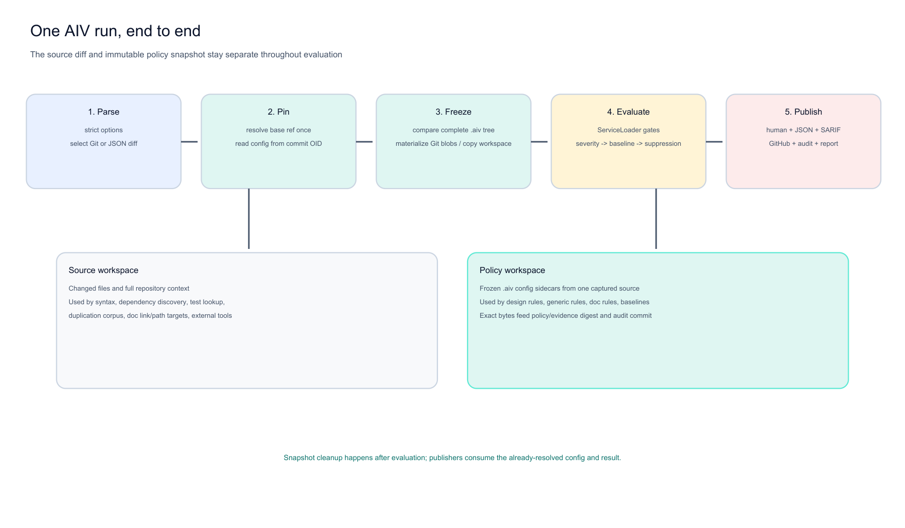

# AIV Integrity Gate architecture

This document explains the complete AIV architecture from an untrusted code change to a policy-bound verdict, GitHub feedback, and tamper-evident evidence. It covers all 25 Maven reactor projects, the 16 runtime gates, immutable policy handling, agent and AI-DLC integration, and deployment choices.

For a hands-on walkthrough, start with [HELLO-WORLD.md](HELLO-WORLD.md). For the decision about which modules and gates to enable, see [MODULE-ADOPTION-GUIDE.md](MODULE-ADOPTION-GUIDE.md).

## 1. System context


**Figure 1: Complete product architecture.** Five entry points call the same composition root: developer/pre-commit, CI/Action, agent/MCP-style wrapper, AI-DLC sensor, and a policy host. The CLI separates the source workspace from the policy boundary. It resolves policy once, freezes it, runs the configured gates, and publishes one result to terminal, JSON, SARIF, GitHub, audit, and report surfaces.

The central design principle is simple: AIV computes evidence, while the repository or orchestration platform decides how that evidence controls workflow. A hard gate can block CI; an advisory gate focuses review; a host can consume `aiv verify` and make its own allow, deny, or human-routing decision.

### Design goals

| Goal | Architectural implementation |
|------|------------------------------|
| Objective blocking | Only reproducible findings use hard severity by default; heuristic review signals stay advisory. |
| Diff focus | Gates receive changed files plus raw unified diff when available; added-line gates do not re-report unrelated legacy code. |
| Immutable policy | One base ref is pinned to a commit OID; config and every `.aiv` sidecar are consumed from one frozen snapshot. |
| Machine contract | Strict RFC 8259 request parsing and versioned verdict JSON. |
| Visible uncertainty | Missing toolchains, unreachable registries, external tools, and model dependencies are surfaced rather than described as verified. |
| Extensibility | Java gates use `ServiceLoader`; project/framework checks use YAML rule packs; existing tools enter through SARIF. |
| Evidence continuity | Stable rule ids, locations, severity, policy digest, evidence digest, and optional audit chain. |

## 2. Maven project and module dependency architecture


**Figure 2: Module dependency map.** The reactor contains one parent/aggregator and 24 child modules. `aiv-api` is the contract foundation. `aiv-core` runs the gate lifecycle. Fifteen plugin modules contribute 16 gate ids because `aiv-plugin-design` contains both `design` and `cohesion`. The Git and GitHub adapters connect the kernel to repositories and review surfaces. Audit, report, and proposal modules provide evidence services. `aiv-cli` bundles the runtime dependency graph into one shaded jar. `aiv-governance` is a separate library and is not bundled into the CLI.

### Exact project count

| Layer | Projects | Count |
|-------|----------|------:|
| Parent build | `aiv-gate` | 1 |
| Contract/kernel | `aiv-api`, `aiv-core` | 2 |
| Gate plugins | density, design, invariant, dependency, doc-integrity, syntax, security, prmeta, license-header, test-adequacy, duplication, package-existence, external, rules, jev | 15 |
| Evidence/governance | `aiv-audit`, `aiv-report`, `aiv-proposal`, `aiv-governance` | 4 |
| Adapters | `aiv-adapter-git`, `aiv-adapter-github` | 2 |
| Distribution | `aiv-cli` | 1 |
| **Total** | parent + 24 children | **25** |

### Dependency direction

```text
aiv-api
  -> aiv-core
  -> every aiv-plugin-*
  -> aiv-adapter-git
  -> aiv-adapter-github

aiv-audit
  -> aiv-report (also depends on aiv-api)
  -> aiv-governance
  -> aiv-proposal (also depends on aiv-api)

aiv-cli
  -> aiv-core
  -> all 15 gate plugin modules
  -> both adapters
  -> aiv-report and aiv-proposal
  -> aiv-api and aiv-audit transitively
```

The dependency graph stays one-way. Gate plugins depend on API contracts and never depend on the CLI. This allows a gate to be tested and embedded independently.

### Key contracts

| Contract | Producer | Consumer |
|----------|----------|----------|
| `DiffProvider` | Git or memory adapter | `Orchestrator` |
| `ConfigProvider` | workspace YAML or pinned Git provider | `Orchestrator` |
| `QualityGate` | plugin modules | `ServiceLoader` / `Orchestrator` |
| `ReportPublisher` | stdout/custom adapters | `Orchestrator` |
| `AIVContext` | `Orchestrator` | every gate |
| `GateResult` / `Finding` | every gate | core, reports, publishers, baselines |
| `AIVResult` | core | CLI, JSON/SARIF/GitHub/audit |

## 3. End-to-end runtime architecture



**Figure 3: One AIV run.** The CLI first parses arguments strictly and selects a Git or memory diff. It resolves the policy source, pins a symbolic ref to one commit OID, and freezes the policy. The core then evaluates gates using two roots: the live source workspace for code/repository evidence and the immutable policy workspace for rules and baselines. Publishers receive the already-computed result. The snapshot is removed after evaluation.

### Phase 1: parse and choose the change source

Normal mode defaults to:

```bash
java -jar aiv-cli.jar --workspace . --diff origin/main --head HEAD
```

`GitDiffProvider` returns changed files, full content, raw unified diff, line counts, author email, signature status, skip directive, and warnings. `--diff-json` and `aiv verify` use `MemoryDiffProvider`, which validates strict JSON and exact change types (`ADDED`, `MODIFIED`, `DELETED`).

Unknown CLI options and missing values return exit 2. A typo in a trust flag cannot be silently ignored.

### Phase 2: resolve and pin policy

For a real Git diff, `GitRefConfigProvider` resolves the base ref to a commit OID exactly once. The same OID is used for:

1. `.aiv/config.yaml`,
2. complete `.aiv` tree listing,
3. live-tree equality checks,
4. every policy blob copied to the snapshot,
5. `policy.commit` in verify output,
6. audit `base_sha` and `policy_commit`.

When non-strict mode cannot resolve base policy, the CLI copies workspace policy once and emits `[POLICY-FALLBACK]`. Strict mode (`--require-trusted-config` or `--require-trusted-policy`) refuses fallback.

### Phase 3: freeze policy

Trusted runs materialize regular `.aiv` Git blobs into a private temporary directory. Workspace runs copy `.aiv` once. The implementation rejects:

- policy references outside `.aiv/`,
- absolute or traversal sidecar paths,
- symbolic-link policy roots and sidecars,
- ignored/untracked extra policy files in strict mode,
- missing/type/content differences from the pinned commit in strict mode.

An explicit CLI baseline is copied into the snapshot as `.aiv/cli-baseline.txt`.

### Phase 4: evaluate gates

`Orchestrator` builds:

```text
AIVContext(
  workspace = source repository,
  policyWorkspace = frozen snapshot,
  diff = filtered changed files + raw diff,
  config = one resolved immutable config,
  metadata = host/PR context
)
```

For each enabled `QualityGate`, the core applies:

```text
gate.evaluate(context)
  -> configured hard/warn severity
  -> baseline from policyWorkspace
  -> inline aiv-disable suppression
  -> aggregate verdict and notices
```

`fail_fast: true` stops after the first blocking result. Doctor mode reports real gate outcomes but returns exit 0 for tuning.

### Phase 5: publish evidence

The result can be sent to:

- human stdout,
- JSON report,
- SARIF 2.1.0 (`error`, `warning`, or `note`),
- GitHub Check annotations,
- inline PR comments,
- advisory/selected-finding labels,
- one managed deterministic findings comment,
- tamper-evident audit log,
- static HTML/JSONL evidence report.

Publication selection is read from the same resolved policy used by the verdict.

## 4. Source workspace versus policy workspace

This separation is load-bearing.

| Source workspace is used for | Policy workspace is used for |
|------------------------------|------------------------------|
| changed file content | `.aiv/config.yaml` decision already resolved |
| dependency manifests and first-party package discovery | design rules |
| conventional test discovery | generic YAML project/framework rule files |
| duplication corpus | documentation rules |
| local documentation link/path targets | baseline suppression file |
| trusted external analyzer execution | exact sidecar bytes bound into evidence |

A gate must use the policy workspace when it reads something that changes what is allowed. It uses the source workspace when it reads the artifact being judged or supporting repository evidence.

## 5. Gate architecture


**Figure 4: Gate catalog.** The 16 gate ids are grouped by evidence job. Change-integrity and behavioral-evidence gates contain the strongest blocking candidates. Review-focus gates are advisory. Governance surfaces are opt-in or advisory. Every gate still uses the same `QualityGate` contract, stable findings, severity pipeline, and report surfaces.

### Change integrity

| Gate | Problem solved | Key output |
|------|----------------|------------|
| `syntax` | guaranteed parse failures or unavailable parser evidence | `syntax.parse`, `syntax.unverified` |
| `invariant` | conflict markers, placeholders, agent paste artifacts, tautology tests | `invariant.*` |
| `dependency` | Java/Python imports not backed by local project evidence | `dependency.unresolved-import` |
| `package-existence` | newly declared package name absent/unverified in a registry | unknown/unverified findings |

### Behavioral evidence

| Gate | Problem solved | Key output |
|------|----------------|------------|
| `test-adequacy` | added test functions with no assertion evidence; production changes with no conventional test | hard assertion-free + advisory missing-test |
| `security` | high-confidence credential material on added lines | vendor/assigned/entropy findings |
| `design` | repository architecture constraints represented as YAML | forbidden/required pattern findings |
| `rules` | project/framework checks without a new Java module | `rules.<pack>.<rule>` |

### Review focus

| Gate | Problem solved | Behavior |
|------|----------------|----------|
| `density` | unusually thin logic/entropy | advisory in recommended profiles |
| `cohesion` | broad multi-area/file changes | advisory |
| `duplication` | exact normalized block copied from existing source | intrinsically advisory |
| `external` | findings from a trusted analyzer already used by the project | tool-configured hard/warn |

### Governance surfaces

| Gate | Problem solved | Behavior |
|------|----------------|----------|
| `doc-integrity` | broken local links, paths, references, commands, required mentions | opt-in hard/warn |
| `pr-metadata` | weak title/body/template/disclosure structure | opt-in hard/warn |
| `license-header` | missing approved markers on new source files | opt-in hard/warn |
| `jev` | calibrated questions needing model judgement | always advisory, external input declared |

The detailed algorithm, configuration, examples, and test map for each gate live in its module README. See [MODULE-ADOPTION-GUIDE.md](MODULE-ADOPTION-GUIDE.md) for recommended combinations.

## 6. Trust and evidence architecture


**Figure 5: Trust chain.** The proposed change is untrusted. A symbolic policy ref is pinned once to an immutable commit. The `.aiv` tree is materialized from those Git blobs into a frozen snapshot. The verdict is bound to request/config/sidecar/commit evidence. An optional OS-locked hash-chain record produces a head that can be anchored outside the log.

### Evidence digest

`aiv verify` computes:

```text
SHA-256(
  exact request bytes
  + canonical resolved config
  + exact frozen sidecar paths and bytes
  + pinned policy commit (or workspace marker)
)
```

The response separately includes `policy.digest`, `policy.commit`, `policy.source`, and `policy.fallback`.

### Human overrides and suppressions

- `/aiv skip` requires a nonempty allow list, matching author email, and Git signature status `G`.
- Rejected skip attempts emit `[SKIP-IGNORED]`.
- Accepted skips emit `[SKIP-HONORED]`.
- File-level suppression must name a rule or family.
- Baseline and inline suppression emit `[SUPPRESSED]` with removed rule ids.
- Strict policy changes fail before the PR can alter its own gate.

### Audit chain

`HashChainAudit.append` uses an in-process monitor plus OS file lock so concurrent workers cannot create sibling heads. Verification detects edits, insertion, deletion, reordering, and optional external-head mismatch. The chain is tamper-evident; independent protection comes from storing the head outside the log.

## 7. Agent and machine interface


**Figure 6: `aiv verify`.** An agent or tool sends strict JSON containing changed files/raw diff and optional policy context. The CLI resolves and freezes policy, runs the same core gates, and returns one schema-v2 JSON object on stdout. Logs remain on stderr. The response includes verdict, findings, policy/evidence digests, external inputs, and optional audit head.

```bash
java -jar aiv-cli.jar verify \
  --request change.json \
  --workspace . \
  --policy-ref origin/main \
  --require-trusted-policy \
  --audit-log .aiv/audit.log
```

`verify --capabilities` is a positive handshake used by the hardened Action. There is no separate MCP server in this repository; an MCP host forwards a tool request to this stable JSON-in/JSON-out contract.

## 8. AI-DLC architecture


**Figure 7: AI-DLC phase integration.** The complete plugin contributes an advisory sensor and a fail-closed sensor. File mode provides fast file-local evidence. Full-request mode carries the raw diff and complete changed-file set for authoritative cross-file evidence. Blocking mode requires a trusted policy ref and rejects undeclared external inputs.

Plugin source:

```text
integrations/aidlc/plugin/
  .aidlc-plugin/plugin.json
  sensors/aidlc-aiv.md
  sensors/aidlc-aiv-blocking.md
  tools/aiv-aidlc-sensor.py
```

See [AIDLC.md](AIDLC.md) and [integrations/aidlc/README.md](../integrations/aidlc/README.md).

## 9. Deployment architecture


**Figure 8: Deployment topology.** Developers normally use a small local profile. CI uses the strict trusted-policy path, machine reports, and an optional audit log. Agents and lifecycle hosts call `aiv verify` or the AI-DLC wrapper. Repository policy is one reviewed input; result outputs feed branch protection, policy engines, or human review.

### Recommended deployment layers

1. **Developer feedback:** `minimal` or project-balanced profile, pre-commit/direct CLI.
2. **CI backstop:** compatible source/release jar, `--require-trusted-config`, JSON + SARIF.
3. **Review surfaces:** Checks, labels, comments as needed.
4. **Evidence:** audit log plus external head anchor; HTML/JSONL reports where useful.
5. **Agent lifecycle:** schema-v2 verify contract or AI-DLC full-request sensor.

## 10. Gate discovery and adding capabilities

All Java gates register their implementation in:

```text
META-INF/services/io.github.vaquarkhan.aiv.port.QualityGate
```

`aiv-cli` shade configuration merges service entries. Add a Java module only when a new capability is required, such as parsing, process execution, or network access. Add project/framework text/structure policy through `aiv-plugin-rules` YAML instead.

### New Java gate checklist

1. Depend on `aiv-api`.
2. Implement `QualityGate`.
3. Return stable structured findings.
4. Register with ServiceLoader.
5. Add module to root POM and CLI dependency graph.
6. Decide default-on/off and hard/advisory posture.
7. Add offline explain content.
8. Add detailed module README and tests.
9. Pass the module coverage gate and full reactor.

## 11. Command and data-flow summary

| Command/path | Diff source | Policy source | Output |
|--------------|-------------|---------------|--------|
| default CLI | Git | pinned base snapshot or visible workspace fallback | human + optional JSON/SARIF/GitHub/audit |
| strict Action/CI | Git | pinned base snapshot, exact live-tree match required | required verdict + JSON/SARIF |
| `--diff-json` | strict JSON file | copied workspace snapshot | same gate pipeline |
| `aiv verify` | stdin/request JSON | trusted Git or workspace snapshot | one schema-v2 JSON object |
| AI-DLC file sensor | one file | verify policy | file-local sensor result |
| AI-DLC full request | full changed set/raw diff | verify trusted policy | authoritative phase evidence |
| `audit verify` | audit log | external expected head optional | intact/broken/head mismatch |
| `report` | verified audit records | labels CSV optional | static HTML + JSONL |
| `proposal` | file/wiki/issue source | template + captured content | proposal findings + optional audit |

## 12. Related documentation

- [HELLO-WORLD.md](HELLO-WORLD.md): exercise every capability one by one.
- [MODULE-ADOPTION-GUIDE.md](MODULE-ADOPTION-GUIDE.md): mandatory/optional modules and recommended profiles.
- [DEVELOPER-CONFIGURATION.md](DEVELOPER-CONFIGURATION.md): full gate/config reference.
- [MCP.md](MCP.md): strict verify schema.
- [AIDLC.md](AIDLC.md): lifecycle sensor integration.
- [EVIDENCE-AND-PROPOSALS.md](EVIDENCE-AND-PROPOSALS.md): audit/report/proposal operations.
- [DEVELOPER-GUIDE.md](DEVELOPER-GUIDE.md): build and extend AIV.

**Author:** Viquar Khan
