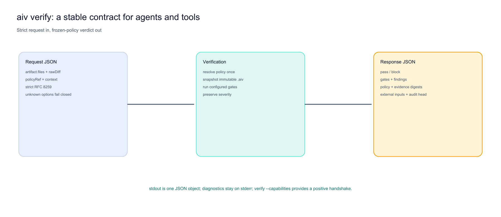

# In-memory and agent verification (`--diff-json`, `aiv verify`)



**Figure 1: Strict request in, policy-bound verdict out.** The machine boundary parses RFC 8259 JSON, freezes policy, runs the same core gate pipeline, and returns one schema-v2 JSON object on stdout. Diagnostics remain on stderr.

Agents and MCP-style tools can run the same gate implementations on a proposed change set without a git commit. Behavioral equivalence to a Git run requires a complete changed-file set and `rawDiff`; a file-only/empty-diff request is intentionally limited to file-local or whole-supplied-file evidence.

## CLI

```bash
java -jar aiv-cli.jar --diff-json proposed.json --workspace .
```

Optional: `--fix` rewrites conflict markers / elision lines on disk, then evaluates cleaned contents.

## JSON shape

```json
{
  "baseRef": "memory",
  "headRef": "proposed",
  "rawDiff": "",
  "files": [
    {
      "path": "src/App.js",
      "changeType": "MODIFIED",
      "content": "const x = 1;\n"
    }
  ]
}
```

`changeType` is one of `ADDED`, `MODIFIED`, `DELETED`; any other value fails closed with exit 2. Escape newlines in `content` as `\\n`.

## MCP wiring

Expose a tool that writes this JSON and execs `aiv-cli` (or shells `scripts/aiv.sh --diff-json …`). There is no separate MCP server binary in this repo; the port is [`MemoryDiffProvider`](../aiv-adapter-git/src/main/java/io/github/vaquarkhan/aiv/adapter/git/MemoryDiffProvider.java).

## `aiv verify` (single verdict, stdout JSON)

`--diff-json` runs the gates but prints the human report. For an agent, an MCP server, or
another tool (for example [mcp-test-harness](https://github.com/vaquarkhan/mcp-test-harness)
or [aegis-mcp-gateway](https://github.com/vaquarkhan/aegis-mcp-gateway)), use `aiv verify`:
it reads one JSON request and writes **one JSON verdict object to stdout, nothing else**.
All diagnostics go to stderr, so stdout is always parseable.

```bash
# request on stdin
echo '{"artifact":{"files":[{"path":"src/A.java","changeType":"MODIFIED","content":"class A {}"}]}}' \
  | java -jar aiv-cli.jar verify --workspace .

# or from a file, with a tamper-evident record appended
java -jar aiv-cli.jar verify --request req.json --workspace . --audit-log verify-audit.log
```

### Request

```json
{
  "artifact": {
    "baseRef": "memory", "headRef": "proposed", "rawDiff": "",
    "files": [ { "path": "src/A.java", "changeType": "MODIFIED", "content": "class A {}" } ]
  },
  "policyRef": "origin/main",
  "context": { "workspace": "." }
}
```

- `artifact` has the same shape as the `--diff-json` body above. If `artifact` is omitted, the
  whole request is read as the diff.
- `policyRef` (optional) reads the gate policy from a trusted git ref, so the change under
  review cannot relax the gate that judges it. Omit it to use the workspace config. Add
  `--require-trusted-policy` to fail closed instead of using workspace policy when the ref is unavailable.
- `context.workspace` (optional) sets the working directory; `--workspace` overrides it.

### Response

```json
{
  "schema_version": 2,
  "aiv_cli_version": "2.0",
  "verdict": "pass",
  "blocking": false,
  "passed": true,
  "advisory": true,
  "gates": [ { "id": "density", "passed": false, "blocks_ci": false, "message": "...",
               "findings": [ { "rule_id": "density.ldr", "file": "src/A.java",
                               "start_line": 1, "start_column": null, "end_line": null,
                               "end_column": null, "message": "..." } ] } ],
  "notices": [],
  "evidence_digest": "sha256:...",
  "policy": { "source": "trusted-ref", "ref": "origin/main", "commit": "abc123...",
              "fallback": false, "digest": "sha256:..." },
  "reproducible_local": true,
  "external_inputs": [],
  "audit": { "record_hash": "...", "log": "verify-audit.log" }
}
```

- `verdict` is `pass` or `block`; `blocking` is `true` only when a hard gate failed. The process
  exit code mirrors the normal gate run, so a caller can gate on stdout JSON or on the exit code.
- `evidence_digest` binds the exact request bytes **and the canonical resolved policy**. The
  `policy` object names the source, ref, resolved base commit, fallback state, and policy digest. The
  base commit binds every tracked policy sidecar under `.aiv/`; `--require-trusted-policy` also
  refuses tracked or untracked workspace drift. A `[POLICY-FALLBACK]`
  notice is emitted whenever trusted-ref resolution degrades to workspace policy.
- `reproducible_local` is true only when the enabled profile has no declared package-registry,
  external-tool, or decision-model input. `external_inputs` lists those dependencies explicitly.
- `audit` is present only with `--audit-log`. Verify the chain later with
  `aiv audit verify <log> --expect-head <record_hash>`.

### MCP wiring

Expose one tool, for example `verify_artifact(artifact, policyRef?, context?)`, that forwards the
request to `aiv verify` on stdin and returns parsed stdout. Because stdout carries only the verdict,
the tool needs no output filtering. There is no separate MCP server binary in this repo; the entry
point is [`VerifyCommand`](../aiv-cli/src/main/java/io/github/vaquarkhan/aiv/cli/VerifyCommand.java).
