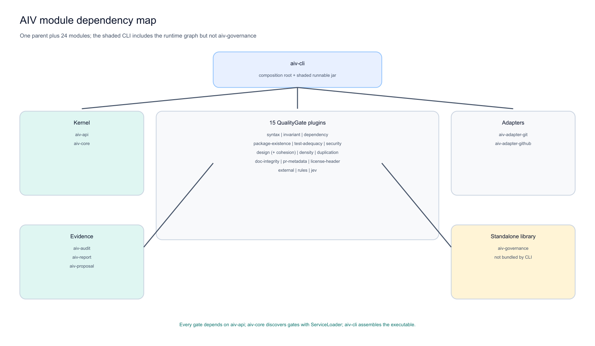

# AIV module and gate adoption guide

AIV contains 24 child modules and 16 gate ids, but a user does not install 24 separate products. The shaded `aiv-cli` jar bundles the runtime graph. You choose which **gates execute** through `.aiv/config.yaml`, which **publishers activate** through flags/environment, and whether standalone evidence/governance commands are used.



**Figure 1: Build modules are not the same as enabled gates.** The CLI bundles the kernel, adapters, gate implementations, reports, proposals, and transitive audit support. `aiv-governance` is the only child code module intentionally outside the CLI dependency graph.

## 1. Three meanings of mandatory

| Meaning | What is mandatory |
|---------|-------------------|
| Build the whole repository | parent plus all 24 child modules (`mvn clean verify`) |
| Run the shaded CLI | `aiv-cli`, `aiv-core`, `aiv-api`, Git/stdout adapters, plus bundled plugin/evidence dependencies |
| Configure a useful repository gate | no universal set; choose an explicit profile based on the problem |

Do not confuse "bundled" with "enabled." A plugin jar can be inside the CLI and remain disabled. Conversely, `package-existence` can be enabled but still need registry access to produce confirmed results.

## 2. Recommended starting rule

For production, list all 16 gate ids explicitly. A partial gate list can inherit framework fallback behavior for omitted default-on gates. The shipped presets are now explicit to prevent that surprise.

Start with:

1. `syntax` and `invariant` for the smallest objective local filter.
2. Add language/project evidence (`dependency`, `design`, `test-adequacy`).
3. Add `security` and `package-existence` when their prerequisites and policy are ready.
4. Keep density, cohesion, and duplication advisory.
5. Add docs/PR/header policy only where the organization values it.
6. Use `external` to reuse trusted tools rather than rebuilding them.
7. Use `rules` for project/framework patterns.
8. Use `jev` only for explicitly advisory judgement questions.

## 3. Gate decision matrix

| Gate | Problem it solves | Recommended status | External need | Best use |
|------|-------------------|--------------------|---------------|----------|
| `syntax` | changed file cannot be parsed | mandatory in every code profile | Python/Node/Go only for those languages | local + CI |
| `invariant` | conflict, placeholder, paste artifact, tautology test | mandatory in generated-change profiles | none | local + CI |
| `dependency` | Java/Python import lacks local manifest evidence | recommended where supported | none | CI |
| `package-existence` | new package name absent/unverified in registry | optional hard/advisory | registry/mirror | CI with network |
| `test-adequacy` | added test has no assertion; production change has no conventional test | recommended | workspace scan | local + CI |
| `security` | recognizable credential appears on added lines | recommended hard tripwire | none | local + CI |
| `design` | code violates repository architecture rules | recommended when rules exist | `.aiv/design-rules.yaml` | CI |
| `rules` | team/framework pattern without new Java module | optional/project-specific | YAML rule files/packs | local + CI |
| `density` | unusually thin Java/entropy structure | advisory | none | review routing |
| `cohesion` | one diff crosses many areas/files | advisory | none | review routing |
| `duplication` | exact normalized added block exists elsewhere | advisory | bounded workspace scan | review routing |
| `external` | trusted existing tool findings need one receipt | optional | installed SARIF tool | CI |
| `doc-integrity` | local docs contain broken/fabricated references or violate doc rules | optional hard/warn | `.aiv/doc-rules.yaml` | docs-heavy repos |
| `pr-metadata` | PR lacks useful title/body/template/disclosure structure | optional | PR event metadata | CI/PR |
| `license-header` | new source lacks approved marker | optional | none | CI |
| `jev` | calibrated question needs model judgement | optional advisory only | model endpoint/key | human review aid |

## 4. Profile matrix

Legend: **H** hard, **A** advisory, **O** off.

| Gate | Minimal | Java CI | Agent-paste strict | Full governed |
|------|:------:|:------:|:------------------:|:-------------:|
| syntax | H | H | H | H (strict toolchains) |
| invariant | H | H | H | H |
| dependency | O | H | H | H |
| package-existence | O | O | H | H/strict with mirror |
| test-adequacy | O | H | H | H + advisory missing tests |
| security | O | O | H | H |
| design | O | H | H | H |
| rules | O | O | O | H/A by rule |
| density | O | A | A | A |
| cohesion | O | A | A | A |
| duplication | O | A | A | A |
| external | O | O | O | H/A by tool |
| doc-integrity | O | O | O | H or A |
| pr-metadata | O | O | O | H or A |
| license-header | O | O | O | H or A |
| jev | O | O | O | A only |

"Full governed" is a pattern, not a shipped preset. Build it explicitly for the repository and enable only tools/services available in its CI environment.

## 5. Shipped presets

| Preset | Exact purpose | Hard gates | Advisory gates | External inputs |
|--------|---------------|------------|----------------|-----------------|
| `minimal` | smallest local filter | syntax, invariant | none | language toolchains when relevant |
| `java-ci` | balanced Java repository | syntax, invariant, dependency, design, test-adequacy | density, cohesion, duplication | no registry/model by default |
| `agent-paste-strict` | broad generated-change filter | syntax, invariant, dependency, design, test-adequacy, security, package-existence | density, cohesion, duplication | package registry |
| `asf` | advisory community-project example | none | license, PR metadata, invariant, package, test, duplication | package registry |
| `airflow` | advisory framework-rule example | none | rules, external, invariant, test, package, security, PR metadata, cohesion, duplication | registry + optional ruff |

Apply one:

```bash
java -jar aiv-cli.jar init --preset minimal --workspace .
java -jar aiv-cli.jar init --preset java-ci --workspace .
java -jar aiv-cli.jar init --preset agent-paste-strict --workspace .
java -jar aiv-cli.jar init --preset asf --workspace .
java -jar aiv-cli.jar init --preset airflow --workspace .
```

Review and commit `.aiv/` to the primary branch before using strict trusted policy.

## 6. All 24 modules

### Contract and kernel

| Module | Mandatory? | Problem solved | Used when |
|--------|------------|----------------|-----------|
| `aiv-api` | runtime foundation | stable models/ports plus strict JSON | every embedded/CLI run |
| `aiv-core` | runtime foundation | deterministic gate lifecycle, severity, baseline, suppression, skip | every gate run |

### Gate plugin modules

| Module | Gate ids | Mandatory? | Problem solved |
|--------|----------|------------|----------------|
| `aiv-plugin-syntax` | `syntax` | recommended | parse validity/unverified toolchain |
| `aiv-plugin-invariant-template` | `invariant` | recommended | merge/paste/placeholder artifacts |
| `aiv-plugin-dependency` | `dependency` | optional by language | undeclared Java/Python import |
| `aiv-plugin-package-existence` | `package-existence` | optional | hallucinated/misspelled declaration |
| `aiv-plugin-test-adequacy` | `test-adequacy` | recommended | assertion-free tests, missing-test advice |
| `aiv-plugin-security` | `security` | recommended tripwire | added-line credential forms |
| `aiv-plugin-design` | `design`, `cohesion` | design optional; cohesion advisory | architecture constraints and diff spread |
| `aiv-plugin-density` | `density` | advisory | structure/entropy review signal |
| `aiv-plugin-duplication` | `duplication` | advisory | exact copied block signal |
| `aiv-plugin-rules` | `rules` | optional | generic project/framework YAML checks |
| `aiv-plugin-external` | `external` | optional | ingest trusted analyzer SARIF |
| `aiv-plugin-doc-integrity` | `doc-integrity` | optional | documentation references/rules |
| `aiv-plugin-prmeta` | `pr-metadata` | optional | PR context structure |
| `aiv-plugin-license-header` | `license-header` | optional | new-file header policy |
| `aiv-plugin-jev` | `jev` | optional advisory | calibrated model judgement questions |

Every plugin is present in the shaded jar so ServiceLoader can discover it. Configuration decides execution.

### Adapters

| Module | Mandatory? | Problem solved |
|--------|------------|----------------|
| `aiv-adapter-git` | yes for Git runs | safe/bounded Git diff plus strict in-memory diff |
| `aiv-adapter-github` | stdout path is part of CLI; GitHub publication optional | terminal, Checks, comments, labels |

### Evidence and command domains

| Module | Mandatory? | Problem solved |
|--------|------------|----------------|
| `aiv-audit` | optional at runtime, transitive in CLI | locked tamper-evident hash chain |
| `aiv-report` | optional command | HTML/JSONL evidence and reviewer-label calibration |
| `aiv-proposal` | optional command | template-driven proposal integrity checks |
| `aiv-governance` | standalone, not CLI-bundled | deterministic delegate/fallback/human routing primitive |

### Distribution

| Module | Mandatory? | Problem solved |
|--------|------------|----------------|
| `aiv-cli` | yes for normal users | shaded composition root, strict commands, immutable policy, reports/publication |

The root `aiv-gate` POM is build metadata/aggregation, not a runtime module.

## 7. What each problem maps to

| If your problem is... | Start with |
|-----------------------|------------|
| agent pastes partial edits/conflicts | invariant + syntax |
| generated tests look green but assert nothing | test-adequacy + invariant |
| imports/packages look invented | dependency + package-existence |
| secrets appear in generated lines | security + external full scanner |
| architecture drifts | design + rules |
| reviewers cannot find risky parts | cohesion + density + duplication (advisory) |
| docs hallucinate paths/commands | doc-integrity |
| PRs arrive without context | pr-metadata |
| new files miss headers | license-header |
| existing analyzers produce separate reports | external |
| AI-DLC needs a phase sensor | `aiv verify` + `integrations/aidlc` |
| auditors need decision history | audit + external anchor + report |
| proposal templates degrade | proposal command + custom template |

## 8. Hard versus advisory decision rule

Promote a check to hard only when:

1. the finding is objective and reproducible,
2. its required parser/tool/service is available or strict unverified behavior is configured,
3. false positives were reviewed on your repository,
4. policy is protected on the primary branch,
5. the team understands suppression/override workflow.

Keep judgement-heavy, structural, and incomplete-context signals advisory.

## 9. Local versus external-input profile

A local reproducible profile excludes package registries, arbitrary external tools, and Jev. A profile using those capabilities remains useful, but `aiv verify` declares:

```json
{
  "reproducible_local": false,
  "external_inputs": ["package-registry", "external-tool", "decision-model"]
}
```

AI-DLC's blocking sensor rejects declared external inputs unless the team deliberately creates a different contract.

## 10. Policy files

Keep every policy-bearing file under `.aiv/`:

```text
.aiv/
  config.yaml
  design-rules.yaml
  doc-rules.yaml
  baseline.txt
  rules/
    team.yaml
```

The CLI pins one commit, checks/loads the complete tree, rejects symlinks/escapes, and gives all policy-bearing gates the same immutable snapshot.

## 11. Build choices for developers

```bash
# full reactor, all 25 projects
mvn clean verify

# one module and required upstream modules
mvn -pl aiv-plugin-syntax -am verify

# CLI dependency closure (excludes standalone governance)
mvn -pl aiv-cli -am verify

# source-built shaded jar
mvn -pl aiv-cli -am clean package
```

Do not run Maven reactors concurrently in the same workspace.

## 12. Recommended adoption sequence

1. Run `minimal` locally.
2. Add dependency/design/test checks matching the language and repository.
3. Run advisory signals for a calibration period.
4. Add registry/external tools only with stable CI prerequisites.
5. Commit reviewed policy to the primary branch.
6. Enable `--require-trusted-config` in CI.
7. Add JSON/SARIF and optional audit.
8. Integrate agents/AI-DLC through full-request `verify` when cross-file evidence matters.

**Author:** Viquar Khan
