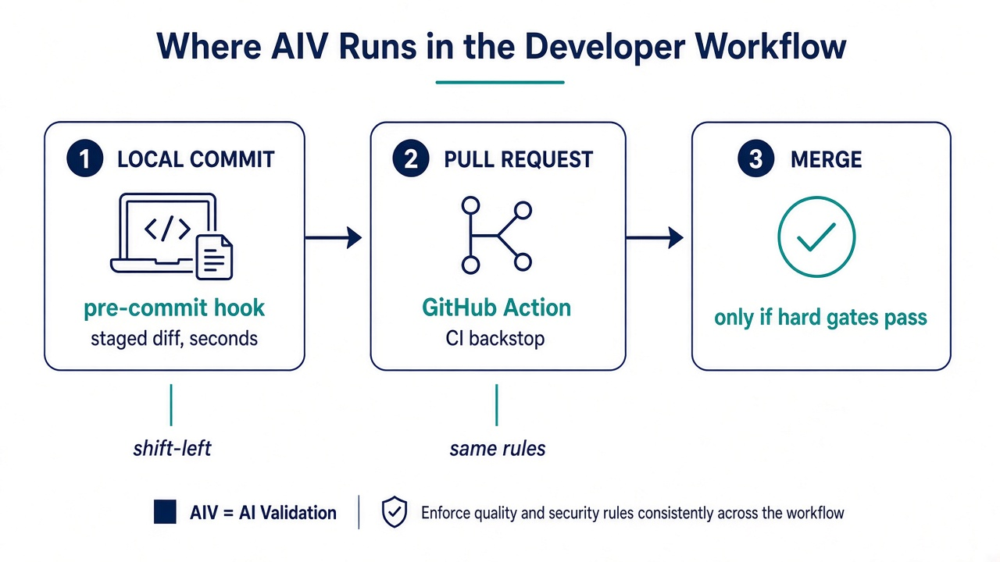

# Pre-commit: run AIV before a pull request exists

Pre-commit gives developers and coding agents immediate feedback on staged change before CI/review.



**Figure 1: Pre-commit is the first layer, not the only layer.** Local checks reduce avoidable CI/review work. Strict CI remains the trusted backstop because local hooks can be skipped and local policy is developer-controlled.

## Requirements

- JDK 17 or newer.
- Git.
- pre-commit (for the hook-repository option).
- curl/PowerShell only when a script downloads a released jar.

## Release 2.0 hook

```yaml
repos:
  - repo: https://github.com/vaquarkhan/aiv-integrity-gate
    rev: v2.0
    hooks:
      - id: aiv-gate
      # - id: aiv-gate-windows
```

```bash
pre-commit install
pre-commit run aiv-gate --all-files
```

The hook evaluates the staged index against `HEAD`.

## Local jar

To run a jar built from tag `v2.0`, point the wrapper at it:

```bash
mvn -pl aiv-cli -am clean package
export AIV_CLI_JAR="$(pwd)/aiv-cli/target/aiv-cli-2.0.jar"
./scripts/aiv-pre-commit.sh
```

Windows PowerShell:

```powershell
$env:AIV_CLI_JAR = (Resolve-Path "aiv-cli\target\aiv-cli-2.0.jar").Path
.\scripts\aiv-pre-commit.ps1
```

## Wrapper environment

| Variable | Purpose |
|----------|---------|
| `AIV_CLI_JAR` | compatible source/release jar path |
| `AIV_VERSION` | stable Maven Central version for download fallback |
| `AIV_WORKSPACE` | repository root |
| `AIV_DIFF_BASE`, `AIV_DIFF_HEAD` | override staged mode with explicit refs |

## Recommended local profile

Use `minimal` initially:

```bash
java -jar "$AIV_CLI_JAR" init --preset minimal --workspace .
```

It enables only syntax and invariant. Add local deterministic gates as the team becomes comfortable. Avoid requiring registries/models/tools on every developer machine unless those dependencies are standard and reliable.

## Suppression and failure workflow

When AIV reports a finding:

1. Fix the objective defect where possible.
2. If the finding is valid but intentionally accepted, use the narrowest rule-scoped suppression.
3. Never use a broad file-level disable without a rule id.
4. Commit policy/suppression changes for review.
5. Let strict CI apply the trusted base policy.

Every accepted baseline/inline suppression is surfaced as `[SUPPRESSED]` in the result/evidence.

## Why CI remains mandatory

A local hook can be skipped, run with different tools, or use workspace fallback. CI should fetch the base ref and run:

```bash
java -jar aiv-cli.jar --workspace . --diff origin/main --head HEAD \
  --require-trusted-config --output-json aiv-report.json --output-sarif aiv-results.sarif
```

See [DEPLOYMENT.md](DEPLOYMENT.md) and [MODULE-ADOPTION-GUIDE.md](MODULE-ADOPTION-GUIDE.md).

**Author:** Viquar Khan
