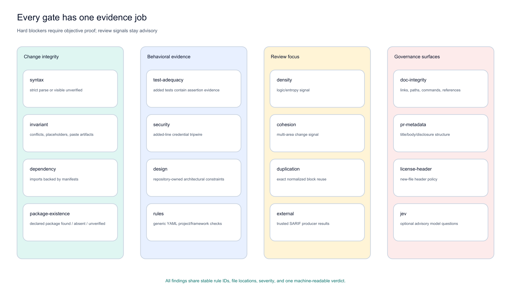
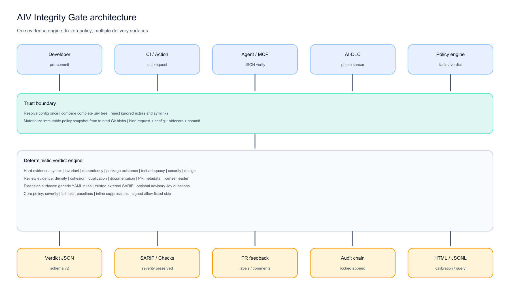
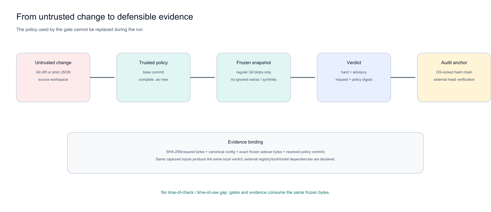

  
Start with the benchmark

  
Turn an untrusted change into a policy-bound, machine-readable verdict before detailed review.

  

    <a class="aiv-btn aiv-btn-benchmark" href="airflow-benchmark/index.html">Open the benchmark</a>
    <a class="aiv-btn" href="benchmark/index.html">Measured results</a>
    <a class="aiv-btn" href="slides/index.html">Presentation deck</a>
    <a class="aiv-btn" href="tutorials/index.html">Tutorials</a>
    <a class="aiv-btn" href="guide/index.html">All docs</a>
  

  <a class="aiv-kpi hot" href="benchmark/index.html">2,098stored patch files executed</a>
  <a class="aiv-kpi hot" href="benchmark/results.html">113blocked by a gate finding</a>
  <a class="aiv-kpi" href="benchmark/index.html">1,803passed. 182 could not be scored</a>
  <a class="aiv-kpi" href="benchmark/index.html">1,219Airflow patch files inside the 2,098-file run</a>

## Start here

  <a class="aiv-card hot" href="airflow-benchmark/index.html">Highlighted<h3>Open the benchmark</h3>
The Airflow walkthrough. Screenshots, method, and what the full run measured.
</a>
  <a class="aiv-card hot" href="benchmark/index.html">Full run<h3>Measured results</h3>
Every stored patch file scored by AIV. 2,098 files, not the 55-case subset.
</a>
  <a class="aiv-card" href="dashboard/index.html">Dashboard<h3>Run dashboard</h3>
Sample data by default; switch to live AIV runs from GitHub Actions or a published report.
</a>
  <a class="aiv-card hot" href="slides/index.html">Slides<h3>Presentation deck</h3>
52 slides: the problem, the end-to-end flow, every gate with its configuration, and the benchmark. PDF and PowerPoint downloads.
</a>
  <a class="aiv-card hot" href="tutorials/index.html">Start<h3>Tutorials index</h3>
Ordered guides for first-time users. No downloads.
</a>
  <a class="aiv-card hot" href="guide/index.html">Docs<h3>All documentation</h3>
Gates, config, deployment, architecture, and more.
</a>
  <a class="aiv-card" href="TUTORIAL/">Tutorial<h3>Quick start</h3>
Install the gate and read a verdict on one change.
</a>
  <a class="aiv-card" href="HELLO-WORLD/">Tutorial<h3>Hello World</h3>
Every gate, one by one, on a small example.
</a>
  <a class="aiv-card" href="GATES/">Docs<h3>One page per gate</h3>
What each gate checks and how a finding is reported.
</a>
  <a class="aiv-card" href="ARCHITECTURE/">Docs<h3>Architecture</h3>
One engine, the delivery surfaces, and how policy is pinned.
</a>

## Every evidence gate

**Figure 1: Sixteen gates, four jobs.** Change-integrity and behavioral gates supply objective blocking candidates. Review-focus gates remain advisory. Governance surfaces are opt-in or advisory. Every result carries stable rule ids and severity.

**Figure 2: One engine, multiple delivery surfaces.** Developers, CI, agents, AI-DLC, and policy hosts call the same gate engine. AIV freezes policy before evaluation and publishes one result to human, machine, GitHub, and audit surfaces.

## Trust the yardstick

**Figure 3: The proposed change cannot replace its own rules.** AIV pins one policy commit, freezes its `.aiv` tree, evaluates against that snapshot, and binds the same commit/bytes into evidence and audit metadata.

## Integrate

  <a class="aiv-card" href="DEPLOYMENT/">Integrate<h3>Deployment and Action</h3>
Run the gate in CI with the hardened GitHub Action.
</a>
  <a class="aiv-card" href="PRE-COMMIT/">Integrate<h3>Pre-commit</h3>
Check a change before it is committed.
</a>
  <a class="aiv-card" href="MCP/">Integrate<h3>Strict verify</h3>
The machine-readable contract for agents and hosts.
</a>
  <a class="aiv-card" href="AIDLC/">Integrate<h3>AI-DLC sensor</h3>
Use the gate as a phase sensor or plugin.
</a>
  <a class="aiv-card" href="DEVELOPER-CONFIGURATION/">Integrate<h3>Configuration</h3>
Policy files, severities, and rule settings.
</a>
  <a class="aiv-card" href="EVIDENCE-AND-PROPOSALS/">Integrate<h3>Audit and proposals</h3>
Evidence, reports, and proposal operations.
</a>

## Build and contribute

- [Developer guide](DEVELOPER-GUIDE/)
- [Module dependency architecture](ARCHITECTURE/#2-maven-project-and-module-dependency-architecture)
- [Documentation map](DOCUMENTATION-MAP/)
- [Tutorials index](tutorials/index.html)
- [Docs index](guide/index.html)
- [GitHub source](https://github.com/vaquarkhan/aiv-integrity-gate)

Apache-2.0 licensed. Author: Viquar Khan.
