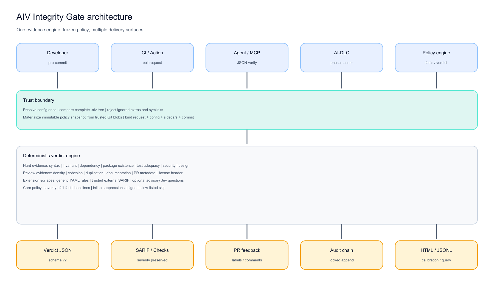
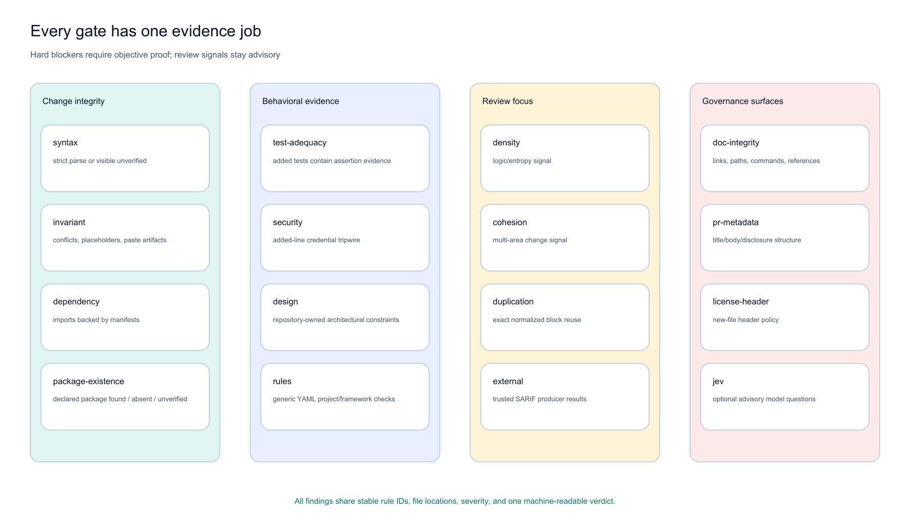
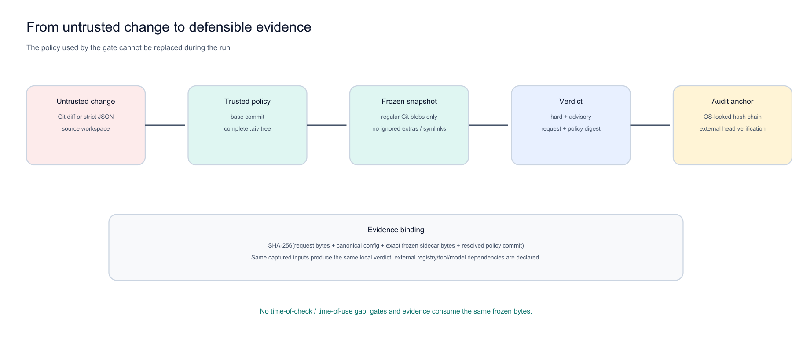

# AIV Integrity Gate

**Turn an untrusted change into a policy-bound, machine-readable verdict before detailed review.**

[Open the benchmark](airflow-benchmark/index.html)

**Figure 1: One engine, multiple delivery surfaces.** Developers, CI, agents, AI-DLC, and policy hosts call the same gate engine. AIV freezes policy before evaluation and publishes one result to human, machine, GitHub, and audit surfaces.

## Start here

- [Benchmark](airflow-benchmark/index.html)
- [Quick start](TUTORIAL.md)
- [Complete Hello World: all gates one by one](HELLO-WORLD.md)
- [One page per gate](GATES.md)
- [Which modules/gates should I use?](MODULE-ADOPTION-GUIDE.md)
- [Detailed architecture](ARCHITECTURE.md)
- [Long-form technical article](blog/AIV-VERIFIABLE-CHANGE.md)

## Every evidence gate

**Figure 2: Sixteen gates, four jobs.** Change-integrity and behavioral gates supply objective blocking candidates. Review-focus gates remain advisory. Governance surfaces are opt-in or advisory. Every result carries stable rule ids and severity.

## Trust the yardstick

**Figure 3: The proposed change cannot replace its own rules.** AIV pins one policy commit, freezes its `.aiv` tree, evaluates against that snapshot, and binds the same commit/bytes into evidence and audit metadata.

## Integrate

- [Deployment and hardened Action](DEPLOYMENT.md)
- [Pre-commit](PRE-COMMIT.md)
- [Strict `aiv verify` / MCP-style contract](MCP.md)
- [AI-DLC sensor/plugin](AIDLC.md)
- [Configuration reference](DEVELOPER-CONFIGURATION.md)
- [Audit/report/proposal operations](EVIDENCE-AND-PROPOSALS.md)

## Benchmark

- [Airflow benchmark walkthrough](airflow-benchmark/index.html): the narrative pages and screenshots.
- [Measured full stored-patch run](benchmark/index.html): every stored patch scored by AIV. The 15,575-row index is metadata only.

## Build and contribute

- [Developer guide](DEVELOPER-GUIDE.md)
- [Module dependency architecture](ARCHITECTURE.md#2-maven-project-and-module-dependency-architecture)
- [Documentation map](DOCUMENTATION-MAP.md)
- [GitHub source](https://github.com/vaquarkhan/aiv-integrity-gate)

Apache-2.0 licensed. Author: Viquar Khan.
