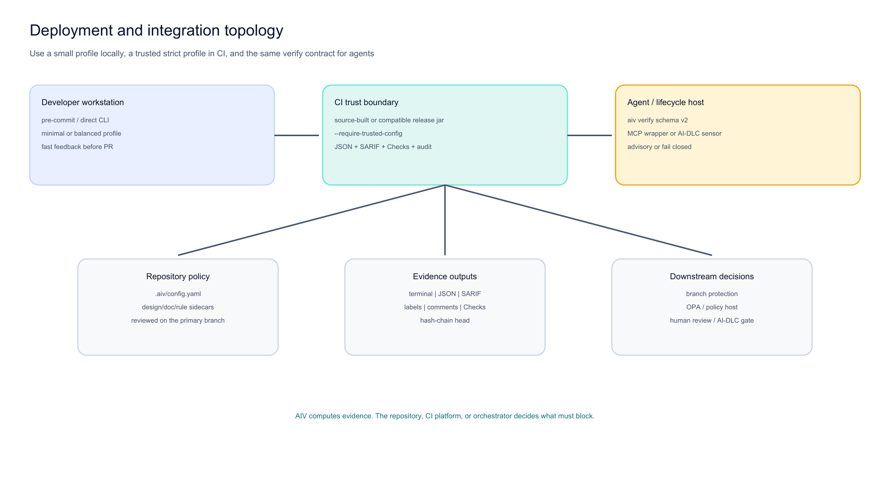

# Deterministic AIV gate followed by advisory model review

Use deterministic evidence first, then spend model/human judgement on a change that cleared the objective boundary.



**Figure 1: CI is the trust boundary.** AIV pins/freeze policy, runs objective gates, and publishes machine evidence. A successful workflow can trigger an advisory model review. The model never changes the AIV verdict.

## Workflow

```text
Pull request
  -> AIV strict gate
       -> syntax/invariant/dependency/test/security/design/rules
       -> external analyzer SARIF as configured
       -> JSON/SARIF/GitHub/audit evidence
  -> success event
       -> Copilot or another model review (advisory)
  -> human merge decision
```

## Why this order

- Deterministic defects do not need model tokens or judgement.
- A model can focus on intent, architecture, maintainability, and surprising interactions.
- Branch protection receives a reproducible hard result.
- Advisory findings/model comments remain visible without pretending to be objective blockers.

## Required AIV command

```bash
java -jar aiv-cli.jar --workspace . --diff origin/main --head HEAD \
  --require-trusted-config --output-json aiv-report.json --output-sarif aiv-results.sarif
```

## Repository workflows

- `.github/workflows/aiv.yml`: builds source, runs strict gate, records report, fails closed.
- `.github/workflows/copilot-review.yml`: listens for successful AIV workflow completion and requests advisory Copilot review.

All third-party Actions are pinned to immutable commit SHAs. The model-review workflow catches permission/configuration failures as advisory warnings rather than merge blockers.

## Separation of responsibilities

| Concern | Owner |
|---------|-------|
| parse/import/package/test/security/design facts | AIV or trusted analyzer |
| policy immutability and evidence digest | AIV CLI |
| contextual judgement | Copilot/other reviewer |
| workflow ordering | GitHub Actions/orchestrator |
| final acceptance | maintainers/branch protection |

## What to measure

Track findings acted on, false-positive labels, review time spent on basic facts, and model comments that found non-deterministic issues. Do not claim a savings percentage without a measured labeled cohort.

**Author:** Viquar Khan
